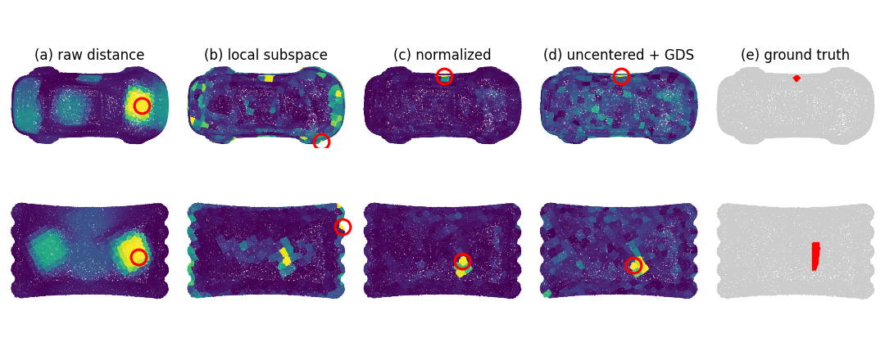

# Subspace Representations for Synthetic-to-Real Transfer in 3-D Surface Inspection

Abdulla Nasir Chowdhury, Naish Ibrahim, Gulpi Qorik Oktagalu Pratamasunu, Kazuhiro Fukui.
ACCV 2026 Workshop on Subspaces in the Era of Foundation Models.

[Paper (arXiv:2611.02744)](https://arxiv.org/abs/2611.02744) ·
[DOI 10.48550/arXiv.2611.02744](https://doi.org/10.48550/arXiv.2611.02744) ·
[Project page](https://abdullah-nasir-chowdhury.github.io/projects/accv2026/)



Inspection models are often trained on synthetic defects because real defects are rare.
The only real data before deployment are scans of good parts. This repository measures
what subspace representations contribute in that setting, in two places:

- **The subspace as a classifier** (synthetic training to MVTec 3D-AD, 1,197 scans).
  Every decision rule ranks real defects at a similar window AUC, and none keeps its
  in-domain threshold. The margin of a nearest-subspace rule moves by at most the part of
  the feature shift outside its class subspaces. That leakage can be measured on unlabeled
  good scans before deployment.
- **The subspace as a model of the good parts** (Real3D-AD, 597 objects). A one-class
  subspace of registered templates on frozen features reaches point AUROC 0.957 on
  pre-registered scans and an object AUROC of 78 to 81, with no training on the benchmark.

## Repository layout

```
dentnet/       DentNet (U-Net on residual height images), synthetic dent generator, training
subspace/      subspace methods: nearest subspace (PBSS), GDS, OMSM, training-free shape subspace
pointnetpp/    PointNet++ encoder trained on the same synthetic windows
common/        shared helpers: thread caps, bootstrap, decision rules, PLY reader
synthetic/     in-domain evaluation on the synthetic benchmark            (Sec. 5.1)
mvtec/         synthetic training to MVTec 3D-AD                          (Sec. 5.2, Table 1, Fig. 1)
real3d/        Real3D-AD, classifier and nominal-subspace stages          (Sec. 5.3 to 5.5, Table 2, Fig. 2)
figures/       the paper's figures and the scripts that draw them
results/       the result files every number in the paper is read from
```

Each experiment folder has a `run.sh` that runs its stages in order.

## Results

The numbers in the paper come from these files, so they can be checked without running
anything.

| in the paper | result file |
|---|---|
| Sec. 5.1, DentNet, PBSS, shape subspace in domain | `results/synthetic/*.json` |
| Sec. 5.1, PointNet++ radius and seed repeats | `results/pointnetpp/radius_sweep.json`, `seed_repeats.json` |
| Table 1, synthetic to MVTec 3D-AD | `results/mvtec/mv_rules_metric.json` (synthetic pitch), `mv_rules_sim.json` (defect scale) |
| Eq. (2), margin bound | `results/mvtec/mv_bound_{metric,sim}.json` |
| Fig. 1, leakage diagnostic | `results/mvtec/mv_leak_{metric,sim}.json` |
| Sec. 5.3, classifier on Real3D-AD | `results/real3d/r3_learned_summary.json` |
| Sec. 5.4, nominal subspace, point AUROC 0.957 | `results/real3d/r3_nominal_report.json` |
| Sec. 5.4, window scale without annotation | `results/real3d/r3_scale_s{1,2,4,8}.json` |
| Table 2, Real3D-AD comparison | `results/real3d/r3_fair_compare.json`, `r3_dinov2_compare_v2.json` |
| Sec. 5.5, registration sensitivity | `results/real3d/r3_reg_sensitivity.json` |
| Fig. 2, qualitative examples | `results/real3d/fig_export/*.npz` |

Both figures can be redrawn from these files alone:

```bash
python figures/make_fig_leak.py
python figures/make_fig_qualitative.py car__624_sink toffees__538_sink --pdf
```

Every hyperparameter (subspace dimension K, GDS dimension R and Q, cluster counts) is
selected on held-out synthetic training samples, never on a real scan.

## Setup

Python 3.10 or newer. A GPU helps but is not required.

```bash
git clone https://github.com/Abdullah-Nasir-Chowdhury/subspace-surface-inspection
cd subspace-surface-inspection
pip install -r requirements.txt
```

**Checkpoint.** The trained DentNet weights are attached to the
[v1.0 release](https://github.com/Abdullah-Nasir-Chowdhury/subspace-surface-inspection/releases/tag/v1.0)
as `best_dentnet_real_scale.pth`
(SHA256 `c5b57fbb23ab9cf89cdf9203b7503295a2953f120c53b9ad5cd0d427153d673c`).
Put it in the repository root, or train it with `python dentnet/train.py` after
generating the synthetic data.

**Data.** The real benchmarks are not redistributed here. Download them from their
authors:

- [MVTec 3D-AD](https://www.mvtec.com/company/research/datasets/mvtec-3d-ad)
  (CC BY-NC-SA 4.0) into `~/data/ext/mvtec_3d_ad/`
- [Real3D-AD](https://github.com/M-3LAB/Real3D-AD) into `~/data/ext/real3d_ad/Real3D-AD-PCD/`

## Running

```bash
bash synthetic/run.sh     # generate the synthetic data, in-domain evaluation
bash pointnetpp/run.sh    # train the PointNet++ encoders
bash mvtec/run.sh         # Table 1, Eq. 2, Fig. 1
bash real3d/run.sh        # Sec. 5.3 to 5.5, Table 2, Fig. 2
```

Outputs go to `~/accv_results*` and logs to `~/accv_logs`. Stages skip outputs that
already exist, so an interrupted run resumes. Set `PY` to choose the interpreter.

## Citation

```bibtex
@inproceedings{chowdhury2026subspace,
  title     = {Subspace Representations for Synthetic-to-Real Transfer in 3-D Surface Inspection},
  author    = {Chowdhury, Abdulla Nasir and Ibrahim, Naish and Pratamasunu, Gulpi Qorik Oktagalu
               and Fukui, Kazuhiro},
  booktitle = {ACCV 2026 Workshop on Subspaces in the Era of Foundation Models},
  year      = {2026},
  eprint    = {2611.02744},
  archivePrefix = {arXiv},
  doi       = {10.48550/arXiv.2611.02744}
}
```

## License

GPL-3.0, inherited from [DentNet](https://github.com/decadenza/DentNet) by Lafiosca et
al. (*Automatic Segmentation of Aircraft Dents in Point Clouds*, SAE Technical Paper
2022-01-0022), whose architecture `dentnet/model.py` implements.
